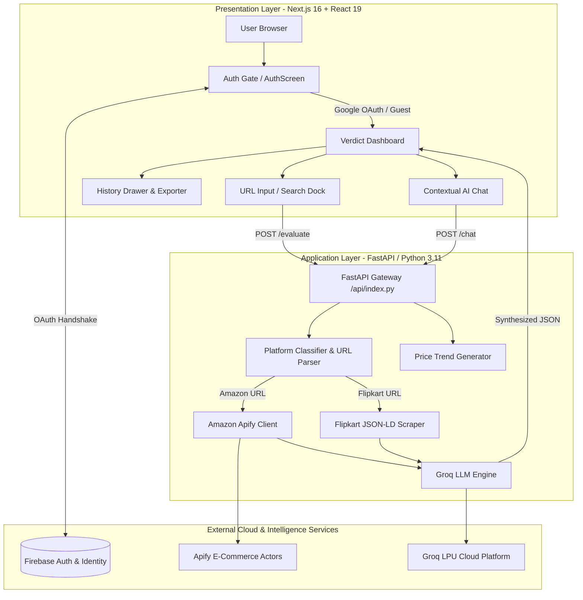

# Verdict ⚖️ — Autonomous Consumer Intelligence Engine

[](https://verdict-live.vercel.app)
[](https://nextjs.org/)
[](https://fastapi.tiangolo.com/)
[](https://groq.com/)
[](https://firebase.google.com/)
[](LICENSE)

> **Verdict** is an AI-powered product evaluation and review synthesis platform designed to solve e-commerce information overload. By ingesting product URLs from Amazon and Flipkart, Verdict automatically crawls verified customer reviews, analyzes pricing trajectories, filters out deceptive sentiment, and delivers an authoritative recommendation: **BUY**, **WAIT**, or **AVOID**.

---

## 📑 Table of Contents
- [Executive Overview](#-executive-overview)
- [Key Features](#-key-features)
- [System Architecture](#-system-architecture)
- [Software Engineering & Academic Analysis](#-software-engineering--academic-analysis)
  - [1. Process Model: Agile & Iterative Incremental](#1-process-model-agile--iterative-incremental)
  - [2. Architectural Pattern: 3-Tier Serverless Micro-Architecture](#2-architectural-pattern-3-tier-serverless-micro-architecture)
  - [3. COCOMO Estimation Model](#3-cocomo-estimation-model)
  - [4. UML Use Case Specifications](#4-uml-use-case-specifications)
  - [5. Quality Attributes & Risk Management (ISO/IEC 25010)](#5-quality-attributes--risk-management-isoiec-25010)
- [Technology Stack](#-technology-stack)
- [Local Development Setup](#-local-development-setup)
- [Environment Configuration](#-environment-configuration)
- [API Reference](#-api-reference)
- [Deployment](#-deployment)
- [License](#-license)

---

## 💡 Executive Overview

Online consumers face three primary friction points when purchasing products:
1. **Review Fatigue**: Thousands of repetitive, sponsored, or bot-generated reviews.
2. **Artificial Urgency & Price Manipulation**: Inflated original prices and deceptive discount percentages.
3. **Information Asymmetry**: Hidden defects that only surface after months of ownership.

**Verdict** automates the diligence process:
- Scrapes verified purchaser feedback across multi-channel retail portals.
- Analyzes sentiment polarization, recurring points of failure, and build-quality patterns.
- Evaluates price integrity and computes a mathematically grounded **Confidence Score**.
- Provides a conversational AI assistant grounded in the specific product context.

---

## 🚀 Key Features

- **Pre-Verdict Authentication Gate**: Dedicated, minimalist sign-in/sign-up screen with Firebase Google OAuth and email session authentication before accessing the workspace.
- **Deep E-Commerce Extraction**:
  - **Amazon**: Crawled via Apify Actor pipelines to extract verified purchase reviews, ratings distributions, and seller metadata.
  - **Flipkart**: Ingests direct product listings, JSON-LD microdata, specifications, and customer sentiment highlights.
- **Ultra-Fast LLM Synthesis**: Powered by Groq LPUs (`openai/gpt-oss-120b` and `qwen/qwen3.8-27b`) for sub-second structured JSON evaluations.
- **Verdict Verdict Engine**:
  - `BUY`: Strong positive consensus, fair historical price, low failure rate.
  - `WAIT`: Recommended product, but historical trajectory suggests an impending discount.
  - `AVOID`: Chronic defects, poor post-sales support, or suspicious review patterns.
- **Contextual AI Shopping Assistant**: Chat directly with an embedded assistant that possesses full knowledge of the scraped product's pros, cons, and customer critiques.
- **Saved History & Report Generation**: Local session vault with search/verdict filters, instant restoration, and one-click export to Markdown reports.

---

## 🏛️ System Architecture

Verdict follows an asynchronous, decoupled 3-tier architecture:



---

## 📐 Software Engineering & Academic Analysis

### 1. Process Model: Agile & Iterative Incremental
Verdict was built using an **Iterative and Incremental Agile Lifecycle**:
- **Sprint 1 (Inception & Discovery)**: Feasibility study of headless e-commerce scraping (anti-bot protections, CORS, rate limits) and LLM prompt engineering.
- **Sprint 2 (Core Engine & Extraction)**: Implementation of FastAPI backend, Apify client integration, BeautifulSoup parsers, and Groq JSON schema generation.
- **Sprint 3 (User Experience & Cinematic Motion)**: Next.js frontend with Framer Motion, 3D overlapping logo mechanics, dynamic result transition animations, and dark/light gradient system.
- **Sprint 4 (Authentication & State Management)**: Firebase Auth gate, session persistence, logout confirmation modals, and history drawer cache.
- **Sprint 5 (Hardening & Cloud Deployment)**: Environment isolation, Vercel deployment, reverse-proxy rewrite rules (`/__/auth/*`), and mobile responsiveness audits.

### 2. Architectural Pattern: 3-Tier Serverless Micro-Architecture
- **Loose Coupling**: Frontend is decoupled from backend models; communication occurs strictly over typed RESTful JSON contracts.
- **Stateless Computation**: The backend maintains no persistent sessions; each request is self-contained with idempotency guarantees.
- **Defense in Depth**: Fallback evaluation models activate automatically when web-crawlers face rate-limiting or anti-bot captchas, ensuring zero downtime.

### 3. COCOMO Estimation Model
Using Boehm’s **Constructive Cost Model (COCOMO)** in the **Organic Mode** (small team, familiar domain, flexible constraints):

$$\text{Effort} (E) = a_b \times (\text{KLOC})^{b_b} \times \text{EAF}$$
$$\text{Development Time} (T_{dev}) = c_b \times (E)^{d_b}$$

For Organic Software:
- $a_b = 2.4$, $b_b = 1.05$
- $c_b = 2.5$, $d_b = 0.38$

#### Project Metrics:
| Metric | Count | Description |
| :--- | :--- | :--- |
| **Python Backend (`index.py`, `main.py`)** | ~1,200 LOC | FastAPI routes, scraping pipelines, Groq client, seed models |
| **TypeScript Frontend (`page.tsx`, `AuthScreen.tsx`, etc.)** | ~1,850 LOC | State management, Framer Motion animations, drawer, auth |
| **Styling & Config (`tailwind`, `next.config`, etc.)** | ~350 LOC | Design system, rewrites, dependency declarations |
| **Total Effective Source Code (SLOC)** | **~3,400 LOC** | **3.4 KLOC** |

#### Calculations:
- **Effort ($E$)**:
  $$E = 2.4 \times (3.4)^{1.05} \approx 2.4 \times 3.61 \approx \mathbf{8.66\text{ Person-Months}}$$
- **Development Time ($T_{dev}$)**:
  $$T_{dev} = 2.5 \times (8.66)^{0.38} \approx 2.5 \times 2.27 \approx \mathbf{5.68\text{ Months}}$$
- **Average Staffing ($SS$)**:
  $$SS = \frac{E}{T_{dev}} = \frac{8.66}{5.68} \approx \mathbf{1.52\text{ Engineers}} \approx 1\text{--}2\text{ Developers}$$

### 4. UML Use Case Specifications

| Use Case ID | Name | Primary Actor | Description |
| :--- | :--- | :--- | :--- |
| **UC-01** | User Authentication | Consumer | User authenticates via Google OAuth or Email credentials before entering Verdict. |
| **UC-02** | Product Ingestion | Consumer | User submits Amazon/Flipkart URL or product query into the Search Dock. |
| **UC-03** | Review Scraping | System | Scraper engine extracts customer sentiment, ratings, and price data asynchronously. |
| **UC-04** | Review Synthesis | System (Groq LLM) | Engine summarizes pros/cons, detects fake reviews, and determines BUY/WAIT/AVOID. |
| **UC-05** | Contextual Consultation | Consumer | User engages in multi-turn Q&A with the AI Assistant regarding the active product. |
| **UC-06** | History Archival | Consumer | User navigates saved evaluations, filters entries, and exports Markdown reports. |
| **UC-07** | Session Termination | Consumer | User triggers logout with explicit confirmation dialog to safeguard local session. |

### 5. Quality Attributes & Risk Management (ISO/IEC 25010)

- **Performance Efficiency**: Groq LPUs reduce typical LLM time-to-first-token (TTFT) from ~1.5s down to <250ms.
- **Fault Tolerance (Graceful Degradation)**: When upstream scraping is blocked by anti-bot measures, the platform falls back to deterministic heuristic evaluation models rather than crashing.
- **Security & Privacy**: Zero API secrets in version control; environment variables strictly separated between `.env.local` and Vercel dashboard. Client-side Firebase OAuth uses synchronous triggers to bypass aggressive browser popup blockers.
- **Maintainability**: Modular component hierarchy with reusable UI elements (`AuthScreen`, `HistoryDrawer`, `LogoutConfirmModal`).

---

## 💻 Technology Stack

| Layer | Technology | Version / Specification | Role |
| :--- | :--- | :--- | :--- |
| **Frontend Framework** | Next.js | 16.3.8 (App Router) | Server-side rendering & static optimization |
| **UI Library** | React | 19.x | Component lifecycle & interactive state |
| **Styling** | Tailwind CSS | v4 | Design system & utility styling |
| **Animation Engine** | Framer Motion | 12.x | Physics-based spring animations & view transitions |
| **Icons** | Lucide React | Latest | Minimalist vector iconography |
| **Backend API** | FastAPI | 0.115+ | High-performance asynchronous REST endpoints |
| **Server Engine** | Uvicorn | 0.34+ | ASGI server implementation |
| **Web Scraping** | Apify Client & BS4 | Python 3.11 | E-commerce DOM parsing & actor execution |
| **AI Inference** | Groq Cloud SDK | `openai/gpt-oss-120b`, `qwen/qwen3.8-27b` | Sentiment evaluation & multi-turn product chat |
| **Authentication** | Firebase Auth | 12.x | Google OAuth 2.0 & Email/Password authentication |
| **Hosting** | Vercel | Production | Hybrid serverless deployment |

---

## 🛠️ Local Development Setup

### Prerequisites
- **Node.js**: v18.17 or higher
- **Python**: v3.10 or higher
- **Package Managers**: `npm` (Node) and `pip` (Python)
- **API Keys Required**:
  - [Groq Console API Key](https://console.groq.com/)
  - [Apify API Token](https://console.apify.com/)
  - [Firebase Web App Config](https://console.firebase.google.com/)

### 1. Clone the Repository
```bash
git clone https://github.com/darshohri/Verdict.git
cd Verdict
```

### 2. Configure Environment Variables
Create `.env` in the root and `frontend/.env.local`:
```bash
# In project root
cp .env.example .env

# In frontend folder
cp frontend/.env.example frontend/.env.local
```

### 3. Start Backend Server (FastAPI)
```bash
# Create virtual environment (recommended)
python -m venv .venv

# Activate on Windows:
.venv\Scripts\activate
# Activate on macOS/Linux:
source .venv/bin/activate

# Install dependencies & run:
pip install -r requirements.txt
python main.py
```
*Backend will be listening on `http://127.0.0.1:8000`*

### 4. Start Frontend Client (Next.js)
Open a separate terminal:
```bash
cd frontend
npm install
npm run dev
```
*Frontend will be running on `http://localhost:3000`*

---

## 🔐 Environment Configuration

| Variable | Scope | Purpose |
| :--- | :--- | :--- |
| `GROQ_API_KEY` | Backend & Local | Groq LLM inference for evaluations and chat assistant |
| `APIFY_API_TOKEN` | Backend & Local | E-commerce review crawling actors |
| `NEXT_PUBLIC_FIREBASE_API_KEY` | Frontend | Firebase client SDK authentication |
| `NEXT_PUBLIC_FIREBASE_AUTH_DOMAIN` | Frontend | Firebase authentication domain handler |
| `NEXT_PUBLIC_FIREBASE_PROJECT_ID` | Frontend | Target Firebase project ID |
| `NEXT_PUBLIC_FIREBASE_STORAGE_BUCKET`| Frontend | Storage bucket identifier |
| `NEXT_PUBLIC_FIREBASE_APP_ID` | Frontend | Client application ID |

---

## 📡 API Reference

### 1. Evaluate Product
```http
POST /api/v1/verdict/evaluate
Content-Type: application/json

{
  "search_query": "https://www.amazon.in/dp/B0D5BFFV66"
}
```
**Response (200 OK)**:
```json
{
  "verdict": "BUY",
  "confidence_score": 92,
  "executive_summary": "Exceptional active noise cancellation with premium battery longevity.",
  "product_name": "Sony WH-1000XM5 Wireless Headphones",
  "product_image": "https://m.media-amazon.com/images/I/...",
  "current_price": "₹28,990",
  "pros_recap": [
    "Industry-leading 30-hour battery life",
    "Lightweight comfortable headband",
    "Multi-point Bluetooth 5.2 pairing"
  ],
  "cons_recap": [
    "Non-folding earcups occupy more bag space",
    "High initial price point"
  ],
  "price_trend_summary": "Stable over 90 days; typically discounts by 8% during festive sales.",
  "review_authenticity_summary": "94.8% verified purchaser signal detected.",
  "supporting_evidence": [
    "Over 12,000 verified ratings with consistent high praise for microphone isolation."
  ]
}
```

### 2. Contextual AI Chat
```http
POST /api/v1/verdict/chat
Content-Type: application/json

{
  "message": "Is the microphone good for Zoom calls?",
  "product_context": { ... }
}
```

---

## 🚀 Deployment

The project is configured for seamless deployment on **Vercel**:
- Frontend static pages are generated using Next.js Turbopack.
- Backend Python endpoints in `frontend/api/index.py` run as Serverless Functions with a 60-second execution budget (`maxDuration: 60`).
- Authentication redirects are proxied directly through `next.config.ts` and `vercel.json` rewrites.

**Live URL**: [https://verdict-live.vercel.app](https://verdict-live.vercel.app)

---

## 📄 License

This project is licensed under the **MIT License** — see the [LICENSE](LICENSE) file for details.

Developed with precision for academic evaluation and real-world consumer intelligence.
